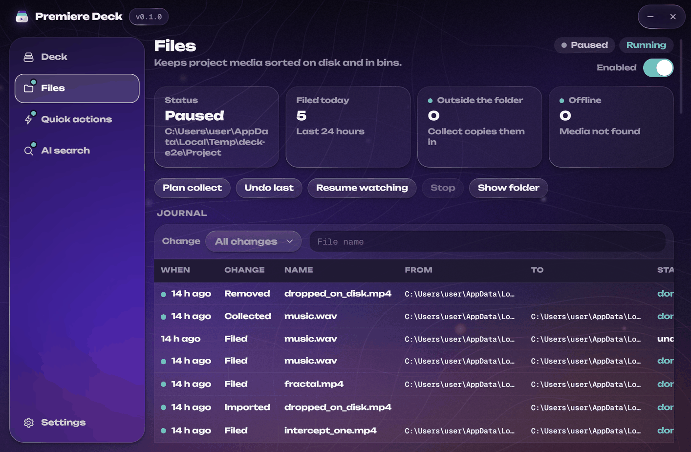
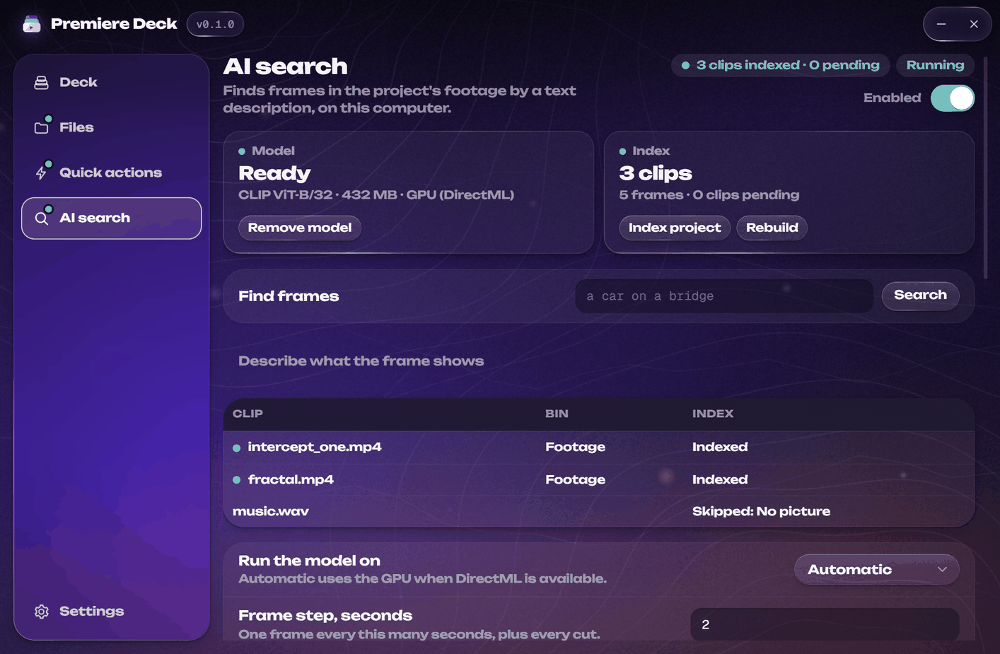

<div align="center">


# Premiere Deck: Adobe Premiere Pro panel with a media organizer, quick actions and local AI footage search for Windows

**Premiere Deck is a Windows application and a small panel inside Adobe Premiere Pro. It keeps project media sorted on disk and in bins, adds one-button versions of routine timeline and project operations, and finds frames in your footage by a text description with a model that runs on your computer. One portable exe, no installer, no account; it installs the panel itself and updates from GitHub Releases.**

[](https://github.com/softoblivion/premiere-deck/releases/latest/download/PremiereDeck.exe)
[](https://github.com/softoblivion/premiere-deck/releases/latest)


[](LICENSE)


<sub>Launch Premiere Pro from the Deck · let Files sort the project media · run quick actions and AI search from the panel.</sub>

</div>

---

## Contents

- [Why Premiere Deck](#why-premiere-deck)
- [Quick start](#quick-start)
- [Features](#features)
- [How it works](#how-it-works)
- [Usage](#usage)
- [Settings](#settings)
- [Data and privacy](#data-and-privacy)
- [Updates](#updates)
- [Building from source](#building-from-source)
- [Project structure](#project-structure)
- [Third-party components](#third-party-components)
- [Disclaimer](#disclaimer)
- [License](#license)

## Why Premiere Deck

- **Routine out of the way.** Operations that take several steps in Premiere's own interface (an adjustment layer over the selection, removing every gap, a numbered project version, a 9:16 copy of a sequence) become single buttons in a panel.
- **Media stays where the project expects it.** Files imported from anywhere are copied into the project folder's layout, relinked and filed into the matching bin; files dropped into the folders on disk are imported into the matching bin; a project item moved between bins moves its file.
- **Your originals are safe.** The Files module copies and journals every change, and each journal entry can be undone. Originals are never moved, renamed or deleted.
- **Search footage by what is in it.** A CLIP model indexes the frames of the project's clips locally; a text query returns clips and times. Nothing is uploaded.
- **Free and open source.** GPL-3.0, no trial, no paid tier, no account, no telemetry; build it yourself if you prefer.
- **Portable.** One `PremiereDeck.exe` with a data folder next to it. Move the folder, move the app.

## Quick start

1. Download [`PremiereDeck.exe`](https://github.com/softoblivion/premiere-deck/releases/latest/download/PremiereDeck.exe) into a folder of its own, for example `D:\Apps\PremiereDeck\`.
2. Run it. The app installs its panel into Premiere's per-user extensions folder.
3. Press **Launch Premiere Pro** on the Deck page, or start Premiere yourself and open **Window > Extensions > Premiere Deck**.

**Requirements:** Windows 10 or 11, Adobe Premiere Pro 2026 (the panel manifest accepts Premiere Pro 14.0 and newer; 2026 is the version it is tested with), and the Microsoft Edge WebView2 Runtime (preinstalled on Windows 11 and on up-to-date Windows 10). No installer, no admin rights. AI search downloads a 432 MB model when it is enabled and uses the GPU through DirectML when one is available, otherwise the CPU.

> [!NOTE]
> The executable is not code-signed, so Windows SmartScreen may warn on first start (**More info → Run anyway**). The panel is not signed with a certificate trusted by Adobe either: if Premiere does not load it, the app offers once, after a confirmation, to turn on Premiere's extension debug mode (a per-user `PlayerDebugMode` value). **Settings** shows the state and can undo it.

## Features

| | |
|---|---|
| **Files** | Keeps project media sorted the same way on disk and in the project panel: copies imported media into the project's folder layout, relinks it and files it into the matching bin; imports files dropped into the layout; mirrors bin moves to disk. **Collect project** fixes an existing project, **Pack for sharing** makes a copied project folder open elsewhere without offline media. A journal lists every change with a per-entry **Undo**. |
| **Quick actions** | 17 buttons for routine timeline and project operations in seven groups: Timeline, Selection, Clips, Tracks, Project, Sequence and Export. Each button can be hidden from the panel. Details in [QUICK_ACTIONS](docs/QUICK_ACTIONS.md). |
| **AI search** | Indexes frames of the project's footage with CLIP ViT-B/32 on your computer. A text query returns clips and times; a result opens in the Source Monitor, is inserted at the playhead or gets a marker. |
| **Panel installs itself** | The app installs, verifies and updates its Premiere panel; **Settings** can reinstall or remove it. The panel only shows what the app sends, so new modules need no panel update. |
| **Self-updating app** | New releases are detected on launch and then every five minutes, downloaded in the background (or on request), verified by size and SHA-256 and installed on **Restart**. The panel updates with the app. |
| **Portable** | One exe and a data folder next to it. The only places outside it are Premiere's per-user extensions folder and the optional debug-mode value. |

## How it works

| Component | Role |
|---|---|
| **Host** (`PremiereDeck.exe`) | Window (Deck, Files, Quick actions, AI search, Settings), tray icon, WebSocket server on `127.0.0.1`, Premiere launcher, panel installer, updater. It owns all logic and state. |
| **Panel** (CEP extension in Premiere Pro) | A thin client: a headless agent runs the ExtendScript the host sends and forwards Premiere events; the visible panel renders what the host sends and returns button presses. |
| **Modules** (Files, Quick actions, AI search) | Each module is code in the host behind one contract: a status, settings, actions, a panel section and a window page. A new module touches nothing in the panel. |

Contracts: [ARCHITECTURE](docs/ARCHITECTURE.md) · [PROTOCOL](docs/PROTOCOL.md) · [MODULES](docs/MODULES.md) · [PANEL](docs/PANEL.md)

## Usage

1. Run `PremiereDeck.exe`. The Deck page shows the Premiere status, the recent projects, the module switches and the activity feed.
2. Press **Launch Premiere Pro** (or **Open project** to start Premiere with a project). If Premiere is already running, open the panel under **Window > Extensions > Premiere Deck**. The status turns to **Connected**.
3. **Files:** open a project and press **Set up project** in the panel or on the Files page. The app creates the layout folders (`Footage`, `Audio`, `Graphics`, `Overlays`, `Motion`, `Exports`, `Project`) and the matching bins. From then on imported media is copied into the layout and filed; **Collect project** copies media that lies outside the project folder, **Pack for sharing** collects and can write a `.zip` beside the project folder. **Undo last** and the journal's **Undo** reverse changes.
4. **Quick actions:** select clips or place the playhead in Premiere and press a button in the panel. **Social copy** and **Export sequence** have a format and a preset choice above their buttons; presets are the built-in ones plus any `.epr` file placed in `premiere-deck_data\presets\`.
5. **AI search:** enable the module, press **Download model**, then **Index project**. Type a description in **Find frames** and press **Search**. A hit offers **Open** (Source Monitor at that time), **Insert** (at the playhead) and **Mark**. New clips are indexed automatically while **Index new clips** is on.

Closing the window hides the app to the tray while Premiere runs; it exits when Premiere exits or on **Quit**.

| Tray menu | Action |
|---|---|
| **Open** | Shows the window |
| **Launch Premiere Pro** | Starts Premiere |
| **Quit** | Exits the app |

<p align="center">
  
  
</p>

## Settings

On the **Settings** page of the window:

| Setting | Meaning |
|---|---|
| **Premiere Pro** | The executable, detected automatically; **Choose file** overrides it, **Use detected** restores it. |
| **Panel** | Installed and bundled version, target folder, extension debug mode state, **Reinstall**, **Remove the panel from Premiere**. |
| **FFmpeg** | Status and source of `ffmpeg` / `ffprobe` (the data folder first, then the system path, else a download). |
| **Data folder** | Location of the app's data, with **Open**. |
| **Keep running with Premiere** | Closing the window hides it to the tray while Premiere Pro is running (default on). |
| **Theme** | Dusk, Nova (default), Frost or Bloom. |
| **Updates** | **Check for updates** and **Download updates automatically** (default on). |

Module settings are on the module pages: the Files layout, folder rules and project switches (watch, enforce bins, mirror bins, import exports, pack as zip); the visibility of each quick action and the export presets folder; the AI search device (Automatic, DirectML or CPU), frame step (default 2 s), excluded bins (default `Overlays, Graphics`) and thumbnail cache size.

## Data and privacy

All runtime data lives in `premiere-deck_data\` next to `PremiereDeck.exe` (override with the `PREMIERE_DECK_HOME` environment variable):

| Path | Content |
|---|---|
| `settings.json` | Preferences |
| `bin\` | `ffmpeg.exe` and `ffprobe.exe` when they are not taken from the system path |
| `models\` | The AI search model files |
| `panel\` | The panel staged for installation |
| `presets\` | Your own Media Encoder export presets (`.epr`) |
| `cache\search\` | Thumbnails of AI search results |
| `logs\` | `host.log` (rotating) and one log per job |
| `webview\` | The window's WebView2 profile |
| `updates\` | Downloaded app updates and the updater's log |

Two locations are outside the data folder, because Adobe dictates them:

- `%APPDATA%\Adobe\CEP\extensions\com.softoblivion.premieredeck\` holds the installed panel; the app owns this folder and writes, replaces and removes it.
- `HKCU\Software\Adobe\CSXS.<n>\PlayerDebugMode` is written only as the fallback described in the note under Quick start, after a confirmation, and removed from **Settings**.

Inside each project folder the app keeps a hidden `.premiere-deck\` folder with the project's layout and settings, the Files journal and the AI search index. It travels with the project when the folder is copied.

Network traffic:

| Destination | When |
|---|---|
| GitHub Releases of `softoblivion/premiere-deck` | Update check and download |
| `github.com/yt-dlp/FFmpeg-Builds` | One download of ffmpeg, only when no ffmpeg is found, verified by SHA-256 |
| `huggingface.co` (`Xenova/clip-vit-base-patch32`, pinned revision) | One download of the AI search model when it is enabled, verified by size and SHA-256 |

Nothing else leaves the computer: no accounts, no telemetry, and no frame, embedding or query is uploaded. The connection between the app and the panel stays on `127.0.0.1`.

## Updates

The app checks GitHub Releases on every launch in the background and then every five minutes. A new version is downloaded on **Download** (or automatically, when that option is on), verified by byte size and SHA-256 against the release's `SHA256SUMS`, and installed by **Restart to update**: the downloaded exe waits for the app to exit, keeps the old file as `PremiereDeck.exe.old` until the new one has started, and relaunches it. If anything fails the current exe stays untouched. At the next start the app installs the matching panel version; Premiere has to be restarted only when the panel's manifest changed. Every release ships two assets: `PremiereDeck.exe` and `SHA256SUMS`. Release notes live in [`docs/releases/`](docs/releases/).

## Building from source

Requirements: Windows, Python 3.14 (via the `py` launcher), PowerShell 5.1+. Node.js is needed only for the panel tests.

```powershell
git clone https://github.com/softoblivion/premiere-deck.git
cd premiere-deck
powershell -ExecutionPolicy Bypass -File build\build.ps1
```

The script creates `.venv`, installs the dependencies, runs the unit tests, generates the panel's version and manifest, and produces `release\PremiereDeck.exe` (one-file PyInstaller build) with `release\SHA256SUMS`. Without a signing certificate (`DECK_SIGN_P12`, `DECK_SIGN_PASSWORD`) it bundles an unsigned panel and prints a warning.

| Task | Command |
|---|---|
| Run from source | `scripts\run_dev.bat` |
| Run without Premiere (mock agent) | `python -m premiere_deck --fake` with `PYTHONPATH=src` |
| Unit tests | `set PYTHONPATH=src` and `set PREMIERE_DECK_HOME=%TEMP%\deck-tests`, then `.venv\Scripts\python.exe -m unittest discover -s tests -t .` |
| Panel tests | `node tests\panel\run.js` |
| Panel development | `powershell -NoProfile -File scripts\panel_dev.ps1` |

Architecture, contracts and build notes: [ARCHITECTURE](docs/ARCHITECTURE.md) · [BUILD](docs/BUILD.md) · [FILES](docs/FILES.md) · [QUICK_ACTIONS](docs/QUICK_ACTIONS.md) · [AI_SEARCH](docs/AI_SEARCH.md) · [HOST_UI](docs/HOST_UI.md)

## Project structure

```
premiere-deck/
├── src/premiere_deck/
│   ├── core/          paths, settings, logging, subprocesses, ffmpeg tools, probing, jobs, updater setup
│   ├── host/          WebSocket server, Premiere launcher, panel installer, module registry, host facade
│   ├── premiere/      Premiere facade (typed operations) and the ExtendScript files behind it
│   ├── modules/       Files, Quick actions and AI search modules behind one contract
│   ├── panel/         the CEP extension installed into Premiere Pro
│   ├── shell/         entry point, window, JS <-> Python bridge, Windows helpers
│   ├── ui/            HTML / CSS / JS of the host window and the vendored Liquid UI kit
│   └── vendor/        vendored self-update library
├── tests/             unittest suite and panel JS tests
├── build/             PyInstaller spec, build script, panel signing script, icon
├── scripts/           development run, panel development link
└── docs/              architecture, protocol, module docs, build notes, release notes, decisions
```

## Third-party components

Bundled into the executable:

| Component | License |
|---|---|
| [CPython](https://www.python.org/) | PSF-2.0 |
| [pywebview](https://github.com/r0x0r/pywebview) | BSD-3-Clause |
| [pythonnet](https://github.com/pythonnet/pythonnet), clr_loader | MIT |
| bottle, proxy_tools | MIT |
| [websockets](https://github.com/python-websockets/websockets) | BSD-3-Clause |
| [watchdog](https://github.com/gorakhargosh/watchdog) | Apache-2.0 |
| [NumPy](https://numpy.org/) | BSD-3-Clause and permissive licenses of bundled parts (see package) |
| [ONNX Runtime](https://github.com/microsoft/onnxruntime) (DirectML build) | MIT |
| [tokenizers](https://github.com/huggingface/tokenizers) | Apache-2.0 |
| [Pillow](https://python-pillow.github.io/) | MIT-CMU |
| [PyInstaller](https://pyinstaller.org/) bootloader | GPL-2.0-or-later with the bootloader exception |
| Liquid UI kit (Unbounded and Geist Mono fonts) | MIT; fonts under SIL OFL 1.1 |
| `CSInterface.js` ([Adobe CEP](https://github.com/Adobe-CEP/CEP-Resources)) | Adobe license, see the file header |

Downloaded at runtime:

| Component | License |
|---|---|
| [FFmpeg](https://ffmpeg.org/) / ffprobe (static GPL build from [yt-dlp/FFmpeg-Builds](https://github.com/yt-dlp/FFmpeg-Builds)) | GPL, see the build |
| CLIP ViT-B/32 as ONNX ([Xenova/clip-vit-base-patch32](https://huggingface.co/Xenova/clip-vit-base-patch32), from OpenAI CLIP) | see model repository |

## Disclaimer

Adobe and Premiere Pro are trademarks of Adobe Inc. Premiere Deck is an independent project and is not affiliated with, endorsed by or sponsored by Adobe.

## License

Released under the [GNU General Public License v3.0](LICENSE). Any distributed copy or derivative work must stay open source under the same license and keep the copyright notices.
