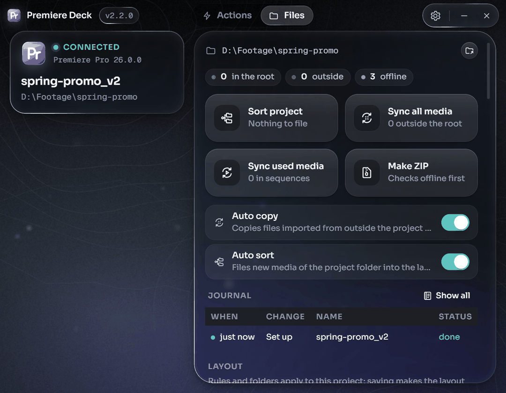
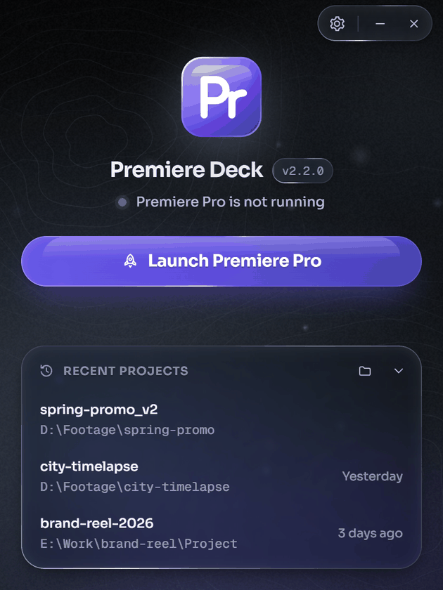
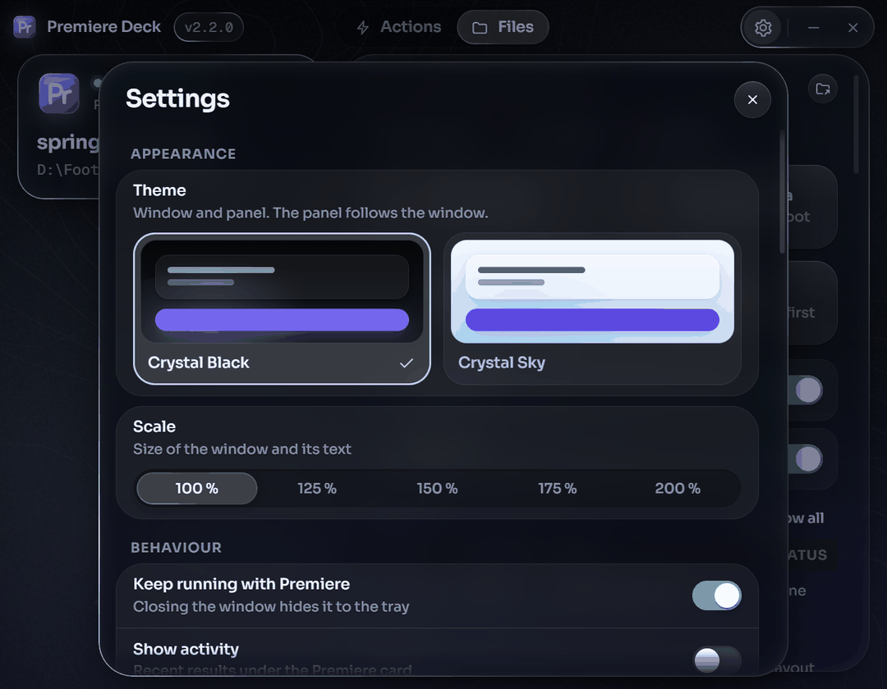

<div align="center">



[](https://github.com/softoblivion/premiere-deck/releases/latest/download/PremiereDeck.exe)
[](https://github.com/softoblivion/premiere-deck/releases/latest)


[](LICENSE)

**Premiere Deck is a Windows application and a small panel inside Adobe Premiere Pro. It sorts project media into folders and bins by content, syncs outside media into the project folder, packs the project into a ZIP, and adds one-button versions of routine timeline and project operations. One portable exe, no installer, no account; it installs the panel itself and updates from GitHub Releases.**



&nbsp;

<sub>Launch Premiere Pro from the Deck · open the panel once · sort and sync project media, run quick actions from the panel.</sub>

</div>

---

## Why Premiere Deck

- **Routine out of the way.** Operations that take several steps in Premiere's own interface (an adjustment layer over the selection, a numbered project version, a copy of a sequence as its next version, a 9:16 copy, a colour label, an added track) become single compact tiles in a panel: an icon beside a short code, four to a row.
- **Media sorted by what it is.** One button files every media item of the project folder into the layout folders and the matching bins: camera footage, stock downloads and generated clips apart; audio as voice, music or effects. Two switches make it automatic: **Auto copy** copies imported files from outside the project into `Media`, **Auto sort** files new media into the layout folders and bins. A project item moved between bins moves its file.
- **Your originals are safe.** Files outside the project folder are only copied, never moved, renamed or deleted. Inside the project folder files move between layout folders only when you press Sort project, when Auto sort is on, or when you move an item between bins, and every change is journaled and can be undone.
- **Free and open source.** GPL-3.0, no trial, no paid tier, no account, no telemetry; build it yourself if you prefer.
- **Portable and offline.** One `PremiereDeck.exe` with a data folder next to it. The audio model ships inside the exe; nothing is downloaded for it and none of your media is uploaded.

## Quick start

1. Download [`PremiereDeck.exe`](https://github.com/softoblivion/premiere-deck/releases/latest/download/PremiereDeck.exe) into a folder of its own, for example `D:\Apps\PremiereDeck\`.
2. Run it. The app installs its panel into Premiere's per-user extensions folder.
3. Press **Launch Premiere Pro** (or start Premiere yourself), then open **Window > Extensions > Premiere Deck** once. Premiere keeps the panel in the workspace, and the Deck window widens when the panel connects.

**Requirements:** Windows 10 or 11, Adobe Premiere Pro 2026 (the panel manifest accepts Premiere Pro 14.0 and newer; 2026 is the version it is tested with), and the Microsoft Edge WebView2 Runtime (preinstalled on Windows 11 and on up-to-date Windows 10). No installer, no admin rights, no GPU, no model download.

> [!NOTE]
> The executable is not code-signed, so Windows SmartScreen may warn on first start (**More info → Run anyway**). The panel is not signed with a certificate trusted by Adobe either: if Premiere does not load it, the waiting screen offers once, after a confirmation, to turn on Premiere's extension debug mode (a per-user `PlayerDebugMode` value). **Settings** shows the state and can undo it.

## Features

| | |
|---|---|
| **Files** | Keeps project media sorted the same way on disk and in the project panel. **Sort project** files the media inside the project folder by content; **Sync all media** and **Sync used media** copy media from outside into a `Media` folder next to the project and relink it; **Make ZIP** packs the project folder into a `.zip` in its `Exports` folder after a check for offline media. Two switches, **Auto copy** and **Auto sort**, decide what happens to media imported later: copied into `Media`, filed into the layout folders and bins, both, or neither (the app then only watches). Files dropped into the layout are imported, and bin moves are mirrored to disk. The journal in the window lists every change with a per-entry **Undo**, and a running job has a **Stop** button. |
| **Folders by content** | Video is told apart by camera tags, camera file names, stock-site names and generator names: camera footage goes to `Footage`, stock downloads to `Stock`, generated clips to `Generated`. Audio goes to `Audio/Voice`, `Audio/Music` or `Audio/SFX`, decided by file names, your own overrides and a small audio model (YAMNet) that runs on the processor in well under a second per file. A wrong guess is corrected by moving the item to another bin. |
| **Quick actions** | 28 compact tiles for routine timeline and project operations in eight groups: Timeline, Tracks, Selection, Clips, Project, Sequence, Export and Keys. **Tracks** adds or removes a video or audio track and has **Solo audio track** and **Lock other tracks** as switches. **Colour label** offers Premiere's 16 label colours for the selected clips, project items and the marker at the playhead. **Sequence** holds **Duplicate sequence** (copies the active sequence as `name v2`, `v3`, ...) and reframed copies at 16:9, 9:16 or a custom width x height; **Save version** is in Project. **Export** opens Premiere's own Export mode for the active sequence and exports the frame at the playhead. **Keys** applies a slow, medium or fast ease to the keyframe pair around the playhead, or sets the pair back to linear. The window can hide any tile from the panel. Codes and details in the [user guide](docs/USER_GUIDE.md#quick-actions) and [QUICK_ACTIONS](docs/QUICK_ACTIONS.md). |
| **Keyframe easing, as far as scripting goes** | Premiere's scripting exposes keyframe times, values and the interpolation type, but no bezier handles. An ease is therefore written as one linear keyframe per frame between the two keyframes, with the values of a bezier curve; **Linear keys** removes those keyframes again. The result looks like an ease and is not an editable bezier. |
| **Panel with tabs and tiles** | Actions and Files tabs inside Premiere Pro (Actions opens first, the last tab is remembered); tiles are half-height, an icon beside a short code, four to a row, in collapsible groups; hovering a tile shows its full name and what it does; a pressed tile turns into a check or a cross, the group keeps the last result line (it hides after 3 s, after 10 s for a warning or an error), and any notice closes on a click. The panel follows the window's theme. |
| **Window that follows Premiere** | A compact start screen with **Launch Premiere Pro** and the three most recent projects; a waiting screen that shows the menu path to open the panel; a wide main view with the Actions and Files tabs in the title bar once the panel is connected. An optional activity strip (**Show activity** in Settings) lists recent results. |
| **Two themes and a Scale setting** | Crystal Black (dark, default) and Crystal Sky (light), set in **Settings** and applied to the window and the panel together. **Scale** (100 % to 200 %) enlarges the window and its text on top of the Windows display scaling, without blur. |
| **Panel installs itself** | The app installs, verifies and updates its Premiere panel; **Settings** can check, reinstall or remove it. The panel only shows what the app sends, so new modules need no panel update. |
| **Self-updating app** | New releases are detected on launch and then every five minutes, downloaded in the background (or on request), verified by size and SHA-256 and installed on **Restart**. The panel updates with the app. |
| **Portable** | One exe and a data folder next to it. The only places outside it are Premiere's per-user extensions folder and the optional debug-mode value. |

## How it works

| Component | Role |
|---|---|
| **Host** (`PremiereDeck.exe`) | Window (compact start and waiting screens, wide Actions and Files tabs, Settings sheet), tray icon, WebSocket server on `127.0.0.1`, Premiere launcher, panel installer, updater. It owns all logic and state. |
| **Panel** (CEP extension in Premiere Pro) | A thin client: a headless agent runs the ExtendScript the host sends and forwards Premiere events; the visible panel (Actions and Files tabs) renders what the host sends and returns button presses. |
| **Modules** (Files, Quick actions) | Each module is code in the host behind one contract: a status, settings, actions, a panel section and a window page. A new module touches nothing in the panel. |

The window has three states that follow Premiere: **idle** (Premiere is not running), **waiting** (Premiere runs, the panel is not open yet) and **connected** (the panel is open; the window widens). The app never opens the panel itself.

## Documentation

| Document | What it covers |
|---|---|
| [User guide](docs/USER_GUIDE.md) | Usage, the Files tab, quick action codes, tray, settings, data folder, network, updates |
| [Architecture](docs/ARCHITECTURE.md) | Goal, stack, repository layout, module table, data flow, runtime data |
| [Protocol](docs/PROTOCOL.md) | Host <-> panel messages: discovery, handshake, UI tree, scripts, events |
| [Modules](docs/MODULES.md) | The module contract: manifest, lifecycle, host services, UI, actions, settings, tests |
| [Premiere facade](docs/PREMIERE_API.md) | Typed Premiere operations, snapshot model, jsx conventions, known Premiere quirks |
| [Panel](docs/PANEL.md) | The CEP panel: manifest, two extensions, install and update, renderer, live verification |
| [Host window](docs/HOST_UI.md) · [bridge](docs/BRIDGE_API.md) | Screens, states and copy of the window; its JS <-> Python bridge |
| [Files module](docs/FILES.md) | Layouts, classification, sorting, sync, ZIP, journal |
| [Quick actions module](docs/QUICK_ACTIONS.md) | Every action with its Premiere calls, results and limits |
| [Build](docs/BUILD.md) | Toolchain, running from source, tests, building and signing, releasing, troubleshooting |
| [Release notes](docs/releases/) | What changed in every version |
| [Third-party components](docs/THIRD_PARTY.md) | What is bundled or downloaded, with licences |

## Building from source

Requirements: Windows, Python 3.14 (via the `py` launcher), PowerShell 5.1+. Node.js is needed only for the panel tests.

```powershell
git clone https://github.com/softoblivion/premiere-deck.git
cd premiere-deck
powershell -ExecutionPolicy Bypass -File build\build.ps1
```

Runtime dependencies (`requirements.txt`): pywebview, pythonnet, websockets, watchdog, numpy and onnxruntime (CPU only). `requirements-dev.txt` adds PyInstaller and Pillow.

The script runs these steps and produces `release\PremiereDeck.exe` (one-file PyInstaller build) with `release\SHA256SUMS`:

1. Creates `.venv`, installs the dependencies and runs the unit tests.
2. Draws the application icon (`build\make_icon.py`).
3. Renders the two themes from `src\premiere_deck\ui\themes.json` into the kit's `themes.css` and the token block of the panel's stylesheet (`build\gen_themes.py`).
4. Writes the panel's version and manifest versions from the application version.
5. Signs the panel; without a signing certificate (`DECK_SIGN_P12`, `DECK_SIGN_PASSWORD`) it bundles an unsigned panel and prints a warning.
6. Bundles the window, the panel, the audio model and the layouts with PyInstaller.

| Task | Command |
|---|---|
| Run from source | `scripts\run_dev.bat` |
| Run without Premiere (mock agent) | `python -m premiere_deck --fake` with `PYTHONPATH=src`; `--fake-state not_running`, `waiting` or `connected` picks the start state, and Alt+1 / Alt+2 / Alt+3 switch it in the window |
| Regenerate the theme CSS | `python build\gen_themes.py` (`--check` only compares) |
| Unit tests | `set PYTHONPATH=src` and `set PREMIERE_DECK_HOME=%TEMP%\deck-tests`, then `.venv\Scripts\python.exe -m unittest discover -s tests -t .` |
| Panel tests | `node tests\panel\run.js` |
| Panel development | `powershell -NoProfile -File scripts\panel_dev.ps1` |

## Disclaimer

Adobe and Premiere Pro are trademarks of Adobe Inc. Premiere Deck is an independent project and is not affiliated with, endorsed by or sponsored by Adobe.

## License

Released under the [GNU General Public License v3.0](LICENSE). Any distributed copy or derivative work must stay open source under the same license and keep the copyright notices.
