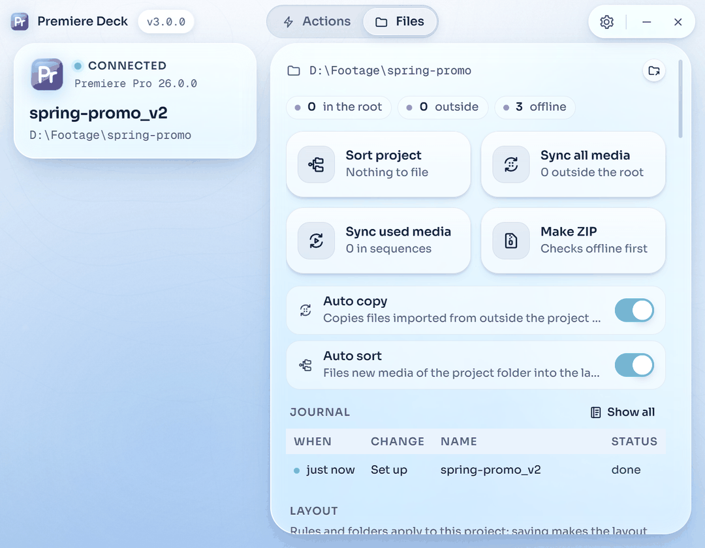
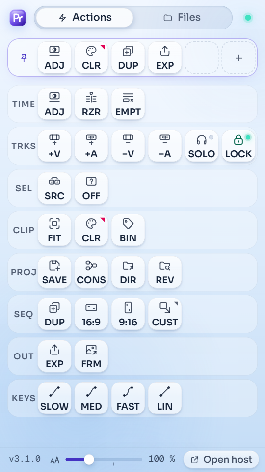
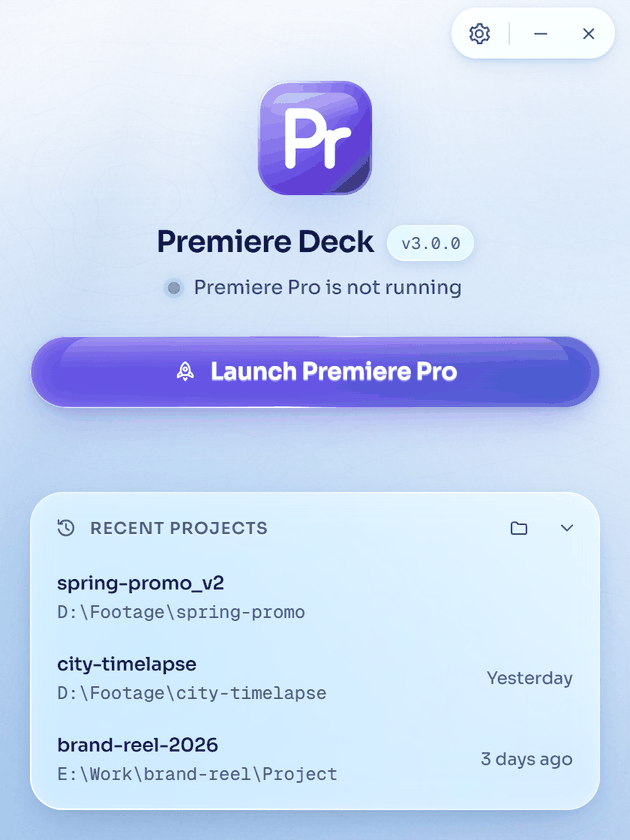

<div align="center">


[](https://github.com/softoblivion/premiere-deck/releases/latest/download/PremiereDeck.exe)
[](https://github.com/softoblivion/premiere-deck/releases/latest)


[](LICENSE)

**Premiere Deck is a Windows application and a small panel inside Adobe Premiere Pro. It sorts project media into folders and bins by content, syncs outside media into the project folder, packs the project into a ZIP, and adds one-button versions of routine timeline and project operations. One portable exe, no installer, no account; it installs the panel itself and updates from GitHub Releases.**

<picture><source media="(prefers-color-scheme: dark)" srcset="docs/assets/screenshot.png"></picture>

<picture><source media="(prefers-color-scheme: dark)" srcset="docs/assets/panel.png"></picture>&nbsp;<picture><source media="(prefers-color-scheme: dark)" srcset="docs/assets/idle.png"></picture>

<sub>Launch Premiere Pro from the window · open the panel once · run actions from the tiles · let the Files tab keep the media sorted.</sub>

</div>

---

## Why Premiere Deck

<table>
<tr>
<td width="33%" valign="top"><br><b>Routine out of the way</b><br>Operations that take several steps in Premiere's own interface (an adjustment layer over the selection, a numbered project version, the next version of a sequence, a 9:16 copy, a colour label, an added track) become single compact tiles in a panel.</td>
<td width="33%" valign="top"><br><b>Your originals are safe</b><br>Files outside the project folder are only copied, never moved, renamed or deleted. Inside it, files move between layout folders only on <b>Sort project</b>, with <b>Auto sort</b> on, or when an item moves between bins; every change is journaled and can be undone.</td>
<td width="33%" valign="top"><br><b>Free and open source</b><br>GPL-3.0, no trial, no paid tier, no account, no telemetry; build it yourself if you prefer. The audio model ships inside the exe: nothing is downloaded for it and none of your media is uploaded.</td>
</tr>
</table>

## Quick start

1. Download [`PremiereDeck.exe`](https://github.com/softoblivion/premiere-deck/releases/latest/download/PremiereDeck.exe) into a folder of its own, for example `D:\Apps\PremiereDeck\`.
2. Run it. The app installs its panel into Premiere's per-user extensions folder.
3. Press **Launch Premiere Pro** (or start Premiere yourself), then open **Window > Extensions > Premiere Deck** once. Premiere keeps the panel in the workspace, and the Deck window widens when the panel connects.

**Requirements:** Windows 10 or 11, Adobe Premiere Pro 2026 (the panel manifest accepts Premiere Pro 14.0 and newer; 2026 is the version it is tested with), and the Microsoft Edge WebView2 Runtime (preinstalled on Windows 11 and on up-to-date Windows 10). No installer, no admin rights, no GPU, no model download.

> [!NOTE]
> The executable is not code-signed, so Windows SmartScreen may warn on first start (**More info → Run anyway**). The panel is not signed with a certificate trusted by Adobe either: if Premiere does not load it, the waiting screen offers once, after a confirmation, to turn on Premiere's extension debug mode (a per-user `PlayerDebugMode` value). **Settings** shows the state and can undo it.

## Features

<table>
<tr>
<td width="50%" valign="top"><br><b>Files organizer</b><br>Keeps project media sorted the same way on disk and in the project panel: camera footage, stock and generated clips apart, audio as voice, music or effects.<details><summary>More</summary><br><b>Sort project</b> files the media inside the project folder by content; <b>Sync all media</b> and <b>Sync used media</b> copy media from outside into a <code>Media</code> folder next to the project and relink it; <b>Make ZIP</b> packs the project folder into a <code>.zip</code> in its <code>Exports</code> folder after a check for offline media; after set-up the SETUP tile re-checks the layout folders and bins. Two automations, <b>Auto copy</b> (an AUTO capsule on SYNC in the panel) and <b>Auto sort</b> (an AUTO capsule on SORT), decide what happens to media imported later: copied into <code>Media</code>, filed into the layout folders and bins, both, or neither (the app then only watches). Files dropped into the layout are imported, and a project item moved between bins moves its file. The journal in the window lists every change with a per-entry <b>Undo</b>, and a running job has a <b>Stop</b> button.<br><br>Video is told apart by camera tags, camera file names, stock-site names and generator names: camera footage goes to <code>Footage</code>, stock downloads to <code>Stock</code>, generated clips to <code>Generated</code>. Audio goes to <code>Audio/Voice</code>, <code>Audio/Music</code> or <code>Audio/SFX</code>, decided by file names, your own overrides and a small audio model (YAMNet) that runs on the processor in well under a second per file. A wrong guess is corrected by moving the item to another bin.</details></td>
<td width="50%" valign="top"><br><b>Quick actions</b><br>29 compact tiles for routine timeline and project operations, an icon over a short code, one row per group.<details><summary>More</summary><br><b>Tracks</b> adds or removes a video or audio track and has <b>Solo audio track</b> and <b>Lock other tracks</b> as switch tiles with a lamp. <b>Sequence</b> holds <b>Duplicate sequence</b> (copies the active sequence as <code>name v2</code>, <code>v3</code>, ...) and reframed copies at 16:9, 9:16 or a custom width x height (set from a mark in the CUST tile's corner); <b>Save version</b> is in Project. <b>Export</b> opens Premiere's own Export mode for the active sequence and exports the frame at the playhead. The window can hide any tile from the panel.<br><br><b>Keys</b> applies a slow, medium or fast ease to the keyframe pair around the playhead, or sets the pair back to linear. Premiere's scripting exposes keyframe times, values and the interpolation type, but no bezier handles, so an ease is written as one linear keyframe per frame with the values of a bezier curve: it looks like an ease and is not an editable bezier. <b>Linear keys</b> removes those keyframes again.</details></td>
</tr>
<tr>
<td width="50%" valign="top"><br><b>Label colours</b><br>Premiere's 16 label colours and the 8 marker colours as one-click rows in the panel, with the names and colours of your Preferences &gt; Labels.<details><summary>More</summary><br>A click colours the newest selection: the clips you selected last on the timeline (through Premiere's own Edit &gt; Label menu) or the items you selected last in the Project panel, bins included; a small chip shows which one a click will colour. A marker colour goes to the markers at the playhead, a range marker included while the playhead is inside it. <b>CLR</b> and <b>MRK</b> repeat the last colour and can be pinned; <b>BIN</b> colours every item by its top-level bin.</details></td>
<td width="50%" valign="top"><br><b>Audio export</b><br>The Audio tab exports the audio tracks you choose as separate files or one mix, rendered by Premiere into the project's <code>Exports\Audio</code> folder.<details><summary>More</summary><br>One switch per audio track of the active sequence; WAV 48 kHz 16-bit, MP3 or AIFF from Premiere's own presets; In to Out when the sequence has both marks, or the entire sequence. Track mutes are set for each file and restored afterwards, existing files are never overwritten, <b>Stop</b> ends the export after the current file, and a file that came out silent (a track soloed in Premiere) is reported.</details></td>
</tr>
<tr>
<td width="50%" valign="top"><br><b>Pinned row</b><br>Up to five tiles of your choice stay in a row at the top of the panel, edited in place and stored by the app.<details><summary>More</summary><br>The panel has Actions, Audio and Files tabs (Actions opens first, the last tab is remembered) and one fixed layout of 360 x 640 px that stays put however the panel is docked, centred when the panel is wider. Hovering a tile shows its full name and what it does; a pressed tile turns into a check or a cross, the row keeps the last result line (it hides after 3 s, after 10 s for a warning or an error), and any notice closes on a click.</details></td>
<td width="50%" valign="top"><br><b>Themes and scale</b><br>Crystal Black (dark, default) and Crystal Sky (light), set in <b>Settings</b> and applied to the window and the panel together.<details><summary>More</summary><br><b>Scale</b> (100 % to 200 %) enlarges the window and its text on top of the Windows display scaling, without blur. A <b>scale slider</b> in the panel's footer (80 % to 150 %; 125 % suits a 2K monitor) scales the whole panel.</details></td>
</tr>
<tr>
<td width="50%" valign="top"><br><b>Self-update</b><br>New releases are detected on launch and then every five minutes, downloaded in the background and installed on <b>Restart</b>.<details><summary>More</summary><br>A download can also be started on request and is verified by size and SHA-256. The app installs, verifies and updates its Premiere panel, and the panel updates with the app; <b>Settings</b> can check, reinstall or remove it. The panel only shows what the app sends, so new modules need no panel update.</details></td>
<td width="50%" valign="top"><br><b>Portable</b><br>One <code>PremiereDeck.exe</code> with a data folder next to it.<details><summary>More</summary><br>The only places outside that folder are Premiere's per-user extensions folder and the optional debug-mode value.</details></td>
</tr>
</table>

<details>
<summary><b>All 29 actions</b></summary>

| Group | Actions |
|---|---|
| **TIME**&nbsp;·&nbsp;Timeline | <kbd>ADJ</kbd> Adjustment layer · <kbd>RZR</kbd> Razor all tracks · <kbd>EMPT</kbd> Delete empty tracks |
| **TRKS**&nbsp;·&nbsp;Tracks | <kbd>+V</kbd> Add video track · <kbd>+A</kbd> Add audio track · <kbd>−V</kbd> Remove video track · <kbd>−A</kbd> Remove audio track · <kbd>SOLO</kbd> Solo audio track · <kbd>LOCK</kbd> Lock other tracks |
| **SEL**&nbsp;·&nbsp;Selection | <kbd>SRC</kbd> Select same source · <kbd>OFF</kbd> Select offline clips |
| **CLIP**&nbsp;·&nbsp;Clips | <kbd>FIT</kbd> Set to frame size |
| **LBL**&nbsp;·&nbsp;Labels | <kbd>CLR</kbd> Colour label · <kbd>MRK</kbd> Marker colour · <kbd>BIN</kbd> Colour labels by bin, with the rows of 16 label and 8 marker colours |
| **PROJ**&nbsp;·&nbsp;Project | <kbd>SAVE</kbd> Save version · <kbd>CONS</kbd> Consolidate duplicates · <kbd>DIR</kbd> Open project folder · <kbd>REV</kbd> Reveal clip file |
| **SEQ**&nbsp;·&nbsp;Sequence | <kbd>DUP</kbd> Duplicate sequence · <kbd>16:9</kbd> Reframe 16:9 · <kbd>9:16</kbd> Reframe 9:16 · <kbd>CUST</kbd> Reframe custom size |
| **OUT**&nbsp;·&nbsp;Export | <kbd>EXP</kbd> Export · <kbd>FRM</kbd> Export frame |
| **KEYS**&nbsp;·&nbsp;Keys | <kbd>SLOW</kbd> Ease slow · <kbd>MED</kbd> Ease medium · <kbd>FAST</kbd> Ease fast · <kbd>LIN</kbd> Linear keys |

What each action does, its results and limits: [user guide](docs/USER_GUIDE.md#quick-actions).

</details>

## How it works

| Component | Role |
|---|---|
| **Host** (`PremiereDeck.exe`) | Window (compact start and waiting screens, wide Actions and Files tabs, Settings sheet), tray icon, WebSocket server on `127.0.0.1`, Premiere launcher, panel installer, updater. It owns all logic and state. |
| **Panel** (CEP extension in Premiere Pro) | A thin client: a headless agent runs the ExtendScript the host sends and forwards Premiere events; the visible panel (Actions and Files tabs) renders what the host sends and returns button presses. |
| **Modules** (Files, Quick actions) | Each module is code in the host behind one contract: a status, settings, actions, a panel section and a window page. A new module touches nothing in the panel. |

The window has three states that follow Premiere: **idle** (Premiere is not running: a compact start screen with **Launch Premiere Pro** and the three most recent projects), **waiting** (Premiere runs, the panel is not open yet: the screen shows the menu path to open it) and **connected** (the panel is open; the window widens and shows the Actions and Files tabs in the title bar). The app never opens the panel itself. An optional activity strip (**Show activity** in Settings) lists recent results.

## Documentation

| Document | What it covers |
|---|---|
| [User guide](docs/USER_GUIDE.md) | Usage, the panel (rows, pinned row, scale slider), the Files tab, quick action codes, tray, settings, data folder, network, updates |
| [Build](docs/BUILD.md) | Toolchain, running from source, tests, building and signing, releasing, troubleshooting |
| [Release notes](docs/releases/) | What changed in every version |
| [Third-party components](docs/THIRD_PARTY.md) | What is bundled or downloaded, with licences |

## Building from source

Requirements: Windows, Python 3.14 (via the `py` launcher), PowerShell 5.1+. Node.js is needed only for the panel tests.

```powershell
git clone https://github.com/softoblivion/premiere-deck.git
cd premiere-deck
powershell -ExecutionPolicy Bypass -File build\build.ps1
```

Runtime dependencies (`requirements.txt`): pywebview, pythonnet, websockets, watchdog, numpy and onnxruntime (CPU only). `requirements-dev.txt` adds PyInstaller and Pillow.

The script runs these steps and produces `release\PremiereDeck.exe` (one-file PyInstaller build) with `release\SHA256SUMS`:

1. Creates `.venv`, installs the dependencies and runs the unit tests.
2. Draws the application icon (`build\make_icon.py`).
3. Renders the two themes from `src\premiere_deck\ui\themes.json` into the kit's `themes.css` and the token block of the panel's stylesheet (`build\gen_themes.py`).
4. Writes the panel's version and manifest versions from the application version.
5. Signs the panel; without a signing certificate (`DECK_SIGN_P12`, `DECK_SIGN_PASSWORD`) it bundles an unsigned panel and prints a warning.
6. Bundles the window, the panel, the audio model and the layouts with PyInstaller.

| Task | Command |
|---|---|
| Run from source | `scripts\run_dev.bat` |
| Run without Premiere (mock agent) | `python -m premiere_deck --fake` with `PYTHONPATH=src`; `--fake-state not_running`, `waiting` or `connected` picks the start state, and Alt+1 / Alt+2 / Alt+3 switch it in the window |
| Regenerate the theme CSS | `python build\gen_themes.py` (`--check` only compares) |
| Regenerate the README icon tiles | `python build\make_readme_svgs.py` (`--check` only compares) |
| Unit tests | `set PYTHONPATH=src` and `set PREMIERE_DECK_HOME=%TEMP%\deck-tests`, then `.venv\Scripts\python.exe -m unittest discover -s tests -t .` |
| Panel tests | `node tests\panel\run.js` |
| Panel development | `powershell -NoProfile -File scripts\panel_dev.ps1` |

## Disclaimer

Adobe and Premiere Pro are trademarks of Adobe Inc. Premiere Deck is an independent project and is not affiliated with, endorsed by or sponsored by Adobe.

## License

Released under the [GNU General Public License v3.0](LICENSE). Any distributed copy or derivative work must stay open source under the same license and keep the copyright notices.
